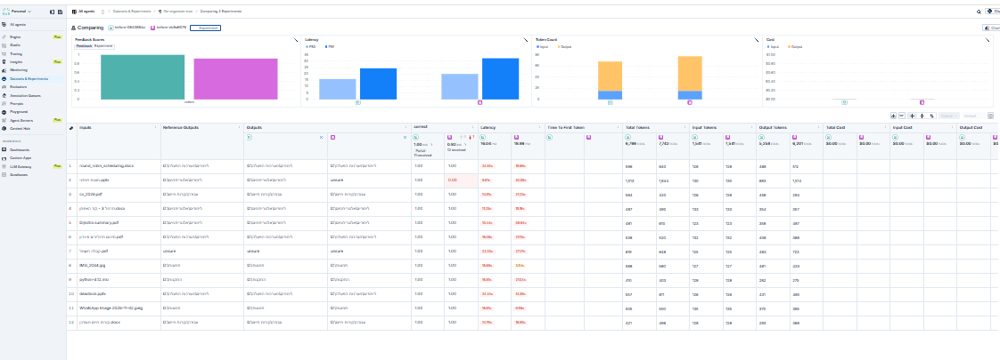
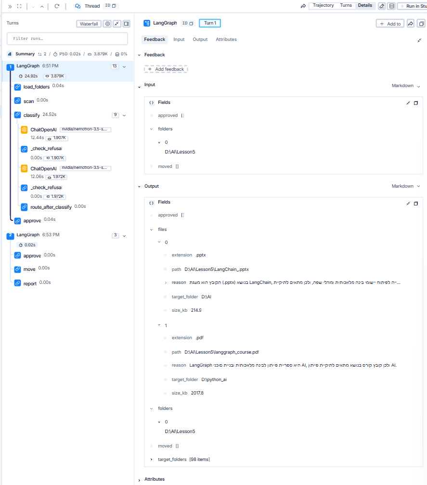

# סוכן לסידור קבצים: LangGraph ו-LangSmith

סוכן שעובר על הקבצים בשולחן העבודה ובתיקיית ההורדות. לכל קובץ הוא בוחר, בעזרת מודל שפה, לאיזו תיקייה **קיימת** בכונן D הוא שייך, לפי המשמעות של שם הקובץ. לדוגמה, `מצגת חמדני.pptx` אמור להגיע ל-`D:\לימודים\אלגוריתמים`. לפני כל העברה הסוכן **עוצר ומבקש אישור** מהמשתמש.

---

## עמידה בדרישות התרגיל

| # | דרישה | איפה בפרויקט |
|---|---|---|
| 1 | שימוש בספריית langgraph | `graph.py`: `StateGraph`, צמתים וקשתות |
| 2 | לולאה או ענף מותנה | `add_conditional_edges` אחרי `classify`, עם הפונקציה `route_after_classify` |
| 3 | interrupt ו-human-in-the-loop | `approve_node` קורא ל-`interrupt`, ו-`main.py` ממשיך עם `Command(resume=...)` |
| 4 | דאטהסט והערכה לפני ואחרי | `evaluate.py`: דאטהסט של 12 דוגמאות, הבודק `correct`, וניסויי `before` ו-`after` |
| 5 | README עם צילומי trace ותובנה | הקובץ הזה |

---

## מבנה הקבצים

| קובץ | תפקיד |
|---|---|
| `state.py` | הגדרת ה-State: `FileItem` (קובץ אחד) ו-`OrganizerState` (המצב של כל הגרף) |
| `graph.py` | הצמתים, הענף המותנה, החיבור למודל ובניית הגרף |
| `main.py` | הרצה אינטראקטיבית: מציג את ההצעות בזמן העצירה, ואז ממשיך |
| `evaluate.py` | יצירת הדאטהסט ב-LangSmith והרצת שני הניסויים |
| `requirements.txt` | רשימת הספריות |
| `install.bat` | יצירת סביבה וירטואלית והתקנת הספריות |
| `.env` | מפתחות API והגדרות tracing. הקובץ לא עולה ל-git |

---

## זרימת הגרף

```
START → load_folders → scan → classify → [ענף מותנה]
                                           ├─ יש קבצים עם תיקייה → approve (interrupt) → move → report → END
                                           └─ אין               → report → END
```

| צומת | מה הוא עושה | מה הוא כותב ל-State |
|---|---|---|
| `load_folders` | סורק את כונן D עד עומק של 2 רמות | `target_folders` |
| `scan` | אוסף קבצים מהתיקיות לסריקה. מדלג על קיצורי דרך ועל הורדות שלא הסתיימו | `files` |
| `classify` | שולח כל שם קובץ למודל ומקבל תיקייה או `unsure` | `files`, עם `target_folder` ו-`reason` לכל קובץ |
| `route_after_classify` | **הענף המותנה**: אם יש קובץ שאינו `unsure`, עובר ל-`approve`, ואחרת ל-`report` | לא משנה את ה-State |
| `approve` | **עוצר** עם `interrupt` ומציג למשתמש את ההצעות | `approved` |
| `move` | מעביר בפועל את הקבצים שאושרו. לא דורס קובץ שכבר קיים ביעד | `moved` |
| `report` | שורת סיכום | `report` |

---

## Human-in-the-loop

- **`interrupt`** ב-`approve_node` עוצר את הגרף ומחזיר ל-`main.py` את רשימת ההצעות.
- **`MemorySaver`** (ה-checkpointer) שומר את ה-State ברגע העצירה. בלי checkpointer אי אפשר להמשיך אחרי העצירה.
- **`thread_id`** מזהה את הריצה, כדי שההמשך יגיע לאותו מצב שמור.
- **`Command(resume=...)`** שולח לגרף את בחירת המשתמש, והגרף ממשיך מ-`approve`.

לכן ריצה שיש בה אישור מורכבת מ**שתי קריאות** ל-`graph.invoke`, ושתיהן מופיעות ב-LangSmith תחת אותו Thread.

---

## החלטות עיצוב

- **Structured output** (המחלקה `Decision` עם pydantic): המודל מחזיר מבנה קבוע (`topic`, `target_folder`, `reason`) ולא טקסט חופשי.
- **השדה `topic` נכתב ראשון:** המודל כותב את השדות לפי הסדר, ולכן הוא מנסח קודם את הנושא של הקובץ, ורק אחר כך בוחר תיקייה על סמך מה שכתב.
- **בדיקת בטיחות:** תיקייה שהמודל מחזיר ושלא קיימת ברשימה הופכת ל-`unsure`. כך המודל לא יכול "להמציא" יעד.
- **`temperature=0`:** תשובות עקביות, כדי שהמדידה תהיה אמינה.
- **Rate limiter:** קריאה כל 4 שניות, בגלל המגבלות של המכסה החינמית.
- **סיווג לפי שם הקובץ בלבד**, בלי לקרוא את התוכן.

### בחירת המודל
התכנון המקורי היה Groq, אבל הכתובת שלו חסומה בסינון הרשת. במהלך העבודה נבדקו עוד ספקים:
- **Gemini:** עמוס במכסה החינמית.
- **Mistral:** דורש תשלום לגישת API.
- **Gemma דרך OpenRouter:** הספק היה עמוס.

בסוף נבחר **`nvidia/nemotron-3.5-super-vl:free` דרך OpenRouter**. בחרנו מודל אחד קבוע, ולא בחירה אקראית של מודל חינמי, כדי שההשוואה בין "לפני" ל"אחרי" תהיה הוגנת.

---

## הרצה

1. `install.bat`: יוצר סביבה וירטואלית ומתקין את הספריות.
2. יוצרים קובץ `.env` עם `OPENROUTER_API_KEY`, `LANGSMITH_API_KEY`, `LANGSMITH_TRACING=true` ו-`LANGSMITH_PROJECT`.
3. `python main.py` מריץ את הסוכן. אפשר גם לתת תיקייה כארגומנט: `python main.py "D:\some\folder"`.
4. `python evaluate.py` מריץ את ההערכה ב-LangSmith.

---

## הערכה ב-LangSmith

- **דאטהסט:** 12 שמות קבצים עם התשובה הנכונה לכל אחד, מול רשימה קבועה של 5 תיקיות בדויות. אחת הדוגמאות היא `קבלה חשמל.pdf`, שהתשובה הנכונה עבורה היא `unsure`.
- **הבודק (`correct`):** התאמה מדויקת בין התשובה של המודל לתשובה הנכונה.

שלוש הרצות של ההערכה, על אותם 12 קבצים ועם אותו מודל:

| הרצה | הפרומפט | `topic` ב-`Decision` | ציון | `מצגת חמדני.pptx` |
|---|---|---|---|---|
| `before-eb9a6076` | בסיסי | לא | 0.91 (11/12) | `unsure` ❌ |
| `before-0843984a` | בסיסי | **כן** | **1.00 (12/12)** | `D:\לימודים\אלגוריתמים` ✅ |
| `after-7c499fb4` | בסיסי ועוד כללים כלליים* | כן | 0.91 (11/12) | `unsure` ❌ |

\* הכללים: התאמה לפי נושא, שימוש בסיומת, לא לנחש, לתרגם שם בעברית לאנגלית ולזהות את הנושא, להעתיק את הנתיב בדיוק. הכללים לא נכתבו בהתאמה לדוגמאות, כדי להימנע מ-overfitting.

**לפני ואחרי השיפור:** ההבדל היחיד בין שתי ההרצות הראשונות הוא הוספת השדה `topic`, והציון עלה מ-0.91 ל-1.00. בצילום רואים את ההשוואה ביניהן:



---

## Trace של ריצת הסוכן



ב-trace רואים את שני ה-Turns של אותו Thread:
- **Turn 1:** `load_folders` ← `scan` ← `classify` (שתי קריאות למודל) ← `route_after_classify` ← `approve`, ושם הגרף עוצר.
- **Turn 2:** `approve` (רץ שוב, והפעם עם התשובה) ← `move` ← `report`.

---

## תובנות

1. **מבנה התשובה השפיע יותר מהוראות בפרומפט.** הוספת השדה `topic` לפני שדה ההחלטה הספיקה כדי שהמודל יזהה ש"חמדני" הוא נושא באלגוריתמים, והציון עלה מ-0.91 ל-1.00. כשהמודל חייב לנסח קודם את הנושא, הבחירה בתיקייה נשענת על מה שכבר כתב.

2. **כללים נוספים יכולים להזיק.** בהרצה עם הכללים, אפילו כלל מפורש לתרגום שמות בעברית, הקובץ `מצגת חמדני.pptx` חזר להיות `unsure`. הכלל "לא לנחש" הפך את המודל לזהיר מדי וגבר על שאר הכללים. בלי מדידה לא היה אפשר לדעת שהשינוי הזה דווקא מוריד את הדיוק.

3. **צוואר הבקבוק הוא המודל.** ב-trace, הצומת `classify` לקח 24.5 מתוך 24.9 שניות של הריצה, כ-12 שניות לכל קובץ. כל שאר הגרף רץ בפחות מעשירית שנייה.

4. **סיווג לפי השם בלבד אינו עקבי.** שני קבצים מאותו קורס (`LangChain_.pptx` ו-`langgraph_course.pdf`) שויכו לשתי תיקיות שונות (`D:\AI` ו-`D:\python_ai`). שיפור אפשרי הוא לקרוא גם את תוכן הקובץ, או לקחת בחשבון את התיקייה שבה הוא נמצא.

**הסתייגות:** הדאטהסט קטן (12 דוגמאות), והשיפור נמדד על דוגמה אחת. כדי לוודא שהוא מחזיק, צריך דאטהסט גדול יותר.
